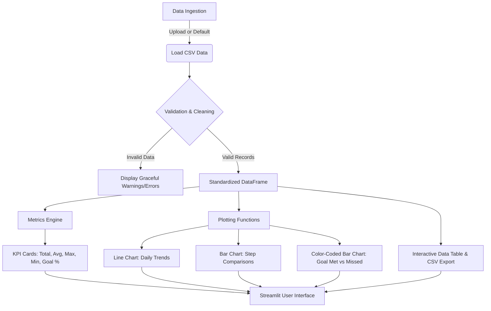

<div align="center">

# 👟 Daily Step Analysis Dashboard

### *Transform raw step-count activity into actionable health insights and interactive visual analytics.*

[](https://www.python.org/)
[](https://streamlit.io/)
[](https://pandas.pydata.org/)
[](https://matplotlib.org/)
[](LICENSE)
[]()

<br />

[Explore Features](#-key-features) •
[Quickstart](#-quick-start) •
[CSV Format](#-csv-data-specification) •
[Dashboard Architecture](#-system-architecture) •
[Troubleshooting](#-troubleshooting)

</div>

---

## 📖 Overview

The **Daily Step Analysis Dashboard** is a lightweight, responsive data analytics application designed to help users track, evaluate, and visualize their daily walking habits. 

Built using **Python**, **Pandas**, **Matplotlib**, and **Streamlit**, it processes daily step counts and caloric expenditure, contrasts performance against customizable daily goals, and generates informative visualizations without requiring external databases, API tokens, or complex setup.

> [!NOTE]
> **Sample Dataset Included**: The repository ships with [`steps.csv`](steps.csv) containing 35 days of realistic synthetic activity data. The application is immediately runnable upon cloning.

---

## ✨ Key Features

| Category | Highlights |
| :--- | :--- |
| **⚡ Instant Out-of-the-Box Execution** | Works immediately with pre-packaged sample data; no external configuration or database needed. |
| **🎯 Dynamic Goal Adjustment** | Modify your daily step target (default: 8,000 steps) directly in the sidebar with live recalculations. |
| **📌 Real-Time KPI Cards** | View cumulative steps, daily averages, best/lowest activity days, and goal achievement percentages. |
| **📈 Multi-Angle Visualizations** | <ul><li>**Trend Line Chart**: Long-term progress over time with target threshold.</li><li>**Step Comparison Bar Chart**: Daily variance alongside benchmark averages.</li><li>**Goal Achievement Bar Chart**: Color-coded feedback (Green for met, Red for missed).</li></ul> |
| **🛡️ Robust Data Hygiene** | Gracefully coerces bad date formats, removes invalid/negative values, handles missing data, and provides clear user warnings. |
| **📂 Flexible File Ingestion** | Upload custom CSV files with automatic schema mapping and instant dashboard refresh. |
| **📥 Export Capabilities** | Export cleaned records and download sample format templates directly from the browser. |

---

## 🏗️ System Architecture



---

## 📊 Dashboard Preview & UI Layout

```text
+-----------------------------------------------------------------------------------+
|  👟 Daily Step Analysis Dashboard                                                 |
|  Current Data Source: Sample Dataset (steps.csv)                                  |
+-----------------------------------------------------------------------------------+
|  [ Total Steps ]  [ Avg Steps/Day ]  [ Highest Day ]  [ Lowest Day ]  [ Goal Met ] |
|     305,850          8,739             12,800            4,900          24 / 35   |
+-----------------------------------------------------------------------------------+
|  [📈 Daily Steps Trend]   [📊 Daily Comparison]   [🎯 Steps vs Daily Goal]       |
|                                                                                   |
|     |  *                                            | [█] Met   [█] Missed        |
|     | / \   *---*--                                 |  █   █       █              |
|     |/   \_/                                        |  █ █ █ █   █ █              |
|     +--------------                                 +----------------             |
+-----------------------------------------------------------------------------------+
|  📋 Daily Activity Records (Filterable Table & Clean CSV Export)                  |
+-----------------------------------------------------------------------------------+
```

---

## 📁 Repository Structure

```text
daily-step-analysis/
├── .gitignore          # Ignores bytecode, virtual environments, and caches
├── app.py              # Main dashboard application logic & visualizations
├── steps.csv           # 35-day realistic sample dataset (Date, Steps, Calories)
├── requirements.txt    # Project dependencies (Streamlit, Pandas, Matplotlib)
└── README.md           # Modern project documentation
```

---

## 🚀 Quick Start

### 1. Clone the Repository
```bash
git clone https://github.com/Santhosh-chintha/DA-Project-Daily-Step-Analysis.git
cd DA-Project-Daily-Step-Analysis
```

### 2. Set Up a Virtual Environment

<details open>
<summary><b>Windows (PowerShell)</b></summary>

```powershell
python -m venv venv
Set-ExecutionPolicy -Scope Process -ExecutionPolicy Bypass
.\venv\Scripts\Activate.ps1
```
</details>

<details>
<summary><b>Windows (Command Prompt - CMD)</b></summary>

```cmd
python -m venv venv
venv\Scripts\activate.bat
```
</details>

<details>
<summary><b>macOS & Linux</b></summary>

```bash
python3 -m venv venv
source venv/bin/activate
```
</details>

### 3. Install Dependencies
```bash
pip install -r requirements.txt
```

### 4. Launch the Dashboard
```bash
streamlit run app.py
```

The application will automatically spin up in your default browser at `http://localhost:8501`.

---

## 📋 CSV Data Specification

To load your own activity data into the dashboard, supply a CSV file adhering to the format below:

| Column Header | Required | Data Type | Description | Example |
| :--- | :---: | :---: | :--- | :--- |
| `Date` | **Yes** | String / Date | Date in `YYYY-MM-DD` or standard date format | `2024-10-15` |
| `Steps` | **Yes** | Integer | Daily step count ($\ge 0$) | `9120` |
| `Calories_Burned` | Optional | Numeric | Daily calories burned | `2400` |

### Sample Data Format
```csv
Date,Steps,Calories_Burned
2024-10-01,7450,2150
2024-10-02,8200,2280
2024-10-03,9120,2410
2024-10-04,6500,2010
2024-10-05,10400,2560
```

---

## 🔧 Troubleshooting

<details>
<summary><b>PowerShell script execution disabled (<code>PSSecurityException</code>)</b></summary>
<br>

If you receive an error stating `running scripts is disabled on this system`, run this one-time command in your PowerShell session before activating:
```powershell
Set-ExecutionPolicy -Scope Process -ExecutionPolicy Bypass
.\venv\Scripts\Activate.ps1
```
Alternatively, bypass activation and launch directly via:
```powershell
.\venv\Scripts\streamlit.exe run app.py
```
</details>

<details>
<summary><b>Port 8501 is already in use</b></summary>
<br>

Run Streamlit on an alternate port:
```bash
streamlit run app.py --server.port 8502
```
</details>

---

## 👨‍💻 Author

**CHINTHA SANTHOSH REDDY**  
- **GitHub**: [@Santhosh-chintha](https://github.com/Santhosh-chintha)

---

## 📄 License

This project is open-source and distributed under the [MIT License](LICENSE).
